# Generator sprawdzianów 📝

Aplikacja dla rodziców i nauczycieli. Robisz telefonem zdjęcia stron podręcznika, a program układa z nich **kartkówkę lub sprawdzian** z kluczem odpowiedzi.

- **Rodzaje zadań:** otwarte, zamknięte ABC, prawda/fałsz, dopasowania i luki w zdaniach, w dowolnym miksie.
- **Grafiki ze stron:** ilustracje z podręcznika trafiają do zadań bez podpisów, a napisy na rysunkach, które zdradzałyby odpowiedź, są zasłaniane.
- **Rozwiązywanie na komputerze:** dziecko zaznacza odpowiedzi w programie, zadania zamknięte są sprawdzane automatycznie, a rodzic ocenia pytania otwarte – z podpowiedzią oceny od AI.
- **Powtórka błędów:** po rozwiązaniu jednym kliknięciem powstaje powtórka – te same błędne zadania albo nowe zadania z pomylonych zagadnień.
- **Historia wyników:** każde podejście zapisuje się samo; wykres postępów i skuteczność w rodzajach zadań.
- **Rozwiązywanie na tablecie lub telefonie:** kod QR – dziecko rozwiązuje na tablecie w domowej sieci Wi-Fi, wynik wraca do programu.
- **Opcjonalny limit czasu:** odliczanie po kliknięciu „Zaczynam”; po czasie sprawdzian kończy się sam.
- **PDF:** e-podręcznik albo skan w PDF dodasz tak jak zdjęcia – program zapyta, które strony wczytać.
- **Grupy A i B:** druga wersja sprawdzianu dla sąsiada z ławki – przemieszana albo z innymi zadaniami.
- **Sprawdzanie kartki ze zdjęcia:** dziecko rozwiązuje wydrukowany sprawdzian, rodzic robi zdjęcie (albo skan PDF), a AI odczytuje zaznaczenia i pismo i proponuje punkty za zadania otwarte.
- **„Wyjaśnij moje błędy”:** po rozwiązaniu AI tłumaczy dziecku każdą pomyłkę prostym językiem i podpowiada, co doczytać.
- **Quiz-gra:** pytania po kolei na czas, punkty za szybkość i serie poprawnych odpowiedzi – na komputerze albo na tablecie.
- **Tryb klasy:** wiele tabletów z jednym kodem QR, wyniki i ranking quizu na żywo, najczęstsze błędy klasy, zestawienie do Excela.
- **Profile dzieci:** osobna historia, postęp fiszek, odznaki i seria dni nauki dla każdego dziecka.
- **Plan nauki przed sprawdzianem:** wpisujesz datę sprawdzianu, a program codziennie przygotowuje krótką kartkówkę (z naciskiem na wcześniejsze błędy), a dzień przed – próbny sprawdzian.
- **Biblioteka sprawdzianów:** każdy sprawdzian zapisuje się sam, z wyszukiwaniem po tytule, temacie, przedmiocie i treści pytań.
- **Fiszki z materiału:** AI wybiera pojęcia i definicje, a powtórki są rozłożone w czasie – trudne fiszki wracają częściej.
- **Klucz odpowiedzi chroniony hasłem rodzica:** dziecko nie podejrzy rozwiązań.
- **Podsumowanie na końcu sprawdzianu:** tabela punktów, skala ocen i miejsce na podpis rodzica.
- **Poprawki:** każde zadanie można edytować albo podmienić na nowe.
- **Druk i PDF:** sprawdzian i klucz drukują się osobno.
- **Tryb ciemny** i **automatyczne aktualizacje** (nowa wersja pobiera się w tle i instaluje przy zamknięciu programu).

Program działa w systemie Windows, a cały interfejs jest po polsku.

## Zrzuty ekranu

> Strony podręcznika na zrzutach to przykładowe, samodzielnie przygotowane materiały. Zadania ułożył silnik Claude Sonnet.

**Gotowa kartkówka – zadanie z ilustracją ze strony (napisy „łodyga” i „korzeń” zasłonięte, żeby nie zdradzały odpowiedzi)**


<details>
<summary><b>Więcej zrzutów: zadania, rozwiązywanie, kartka ze zdjęcia, quiz, tryb klasy, plan nauki, fiszki, profile, biblioteka</b></summary>

**Ekran startowy – z zadaniami na dziś z planu nauki**

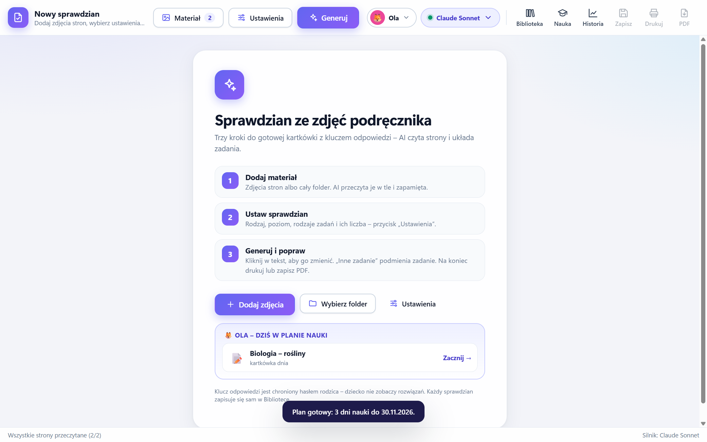

**Edycja zadania – panel obok kartki: inne zadanie, kolejność, punkty, grafika**


**Prawda/fałsz, dopasowania i luki**

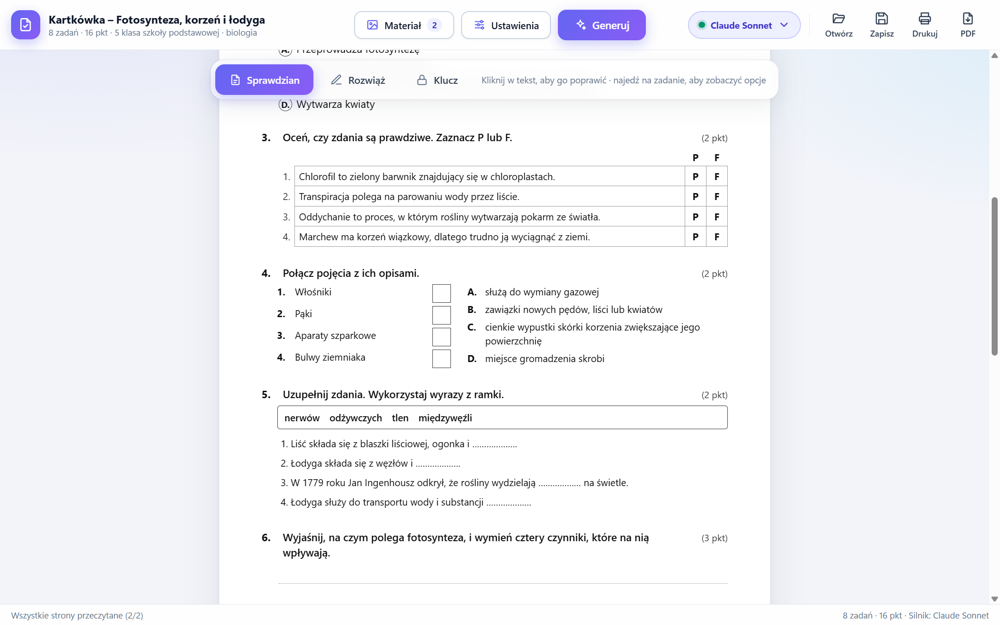

**Materiał – zdjęcia stron podręcznika, odczytane przez AI**


**Ustawienia – poziom trudności, liczba i rodzaje zadań**

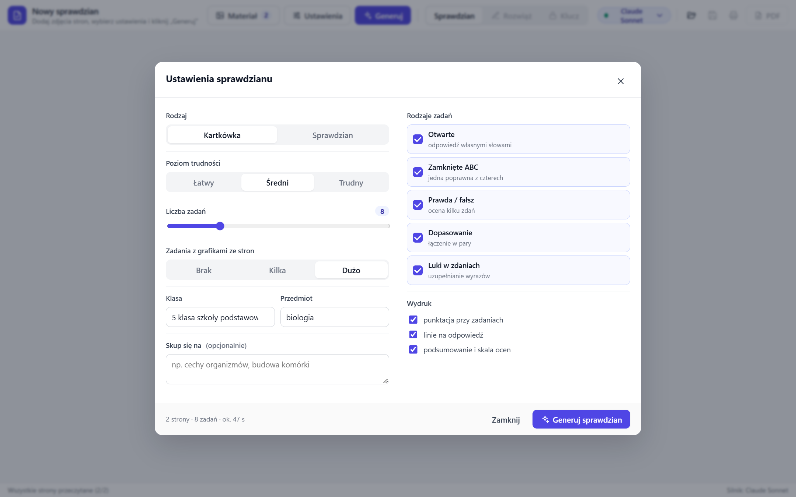

**Rozwiązywanie na komputerze**

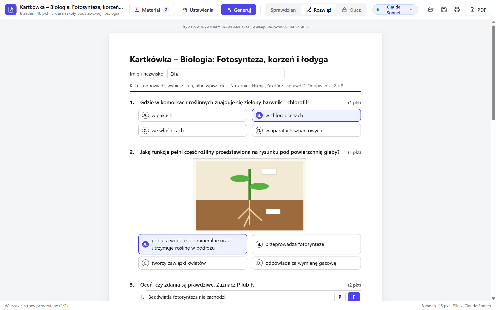

**Wynik, ocena i powtórka błędów**


**Klucz odpowiedzi chroniony hasłem rodzica**

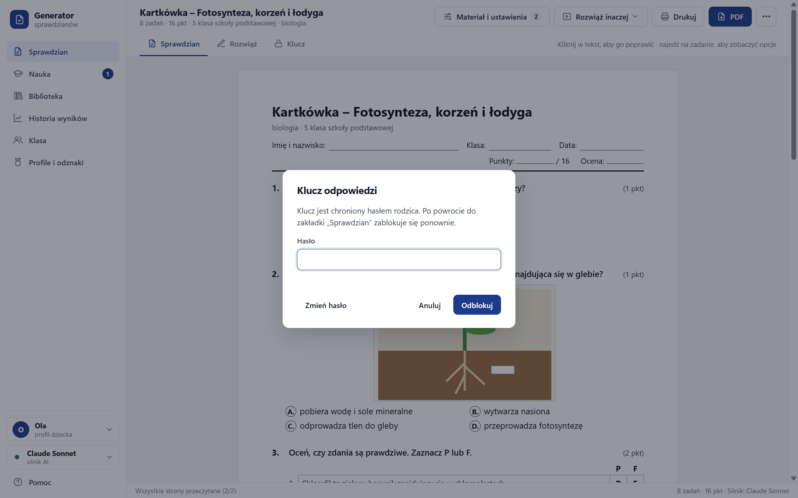


**Podpowiedź oceny zadania otwartego z AI (rodzic zatwierdza)**

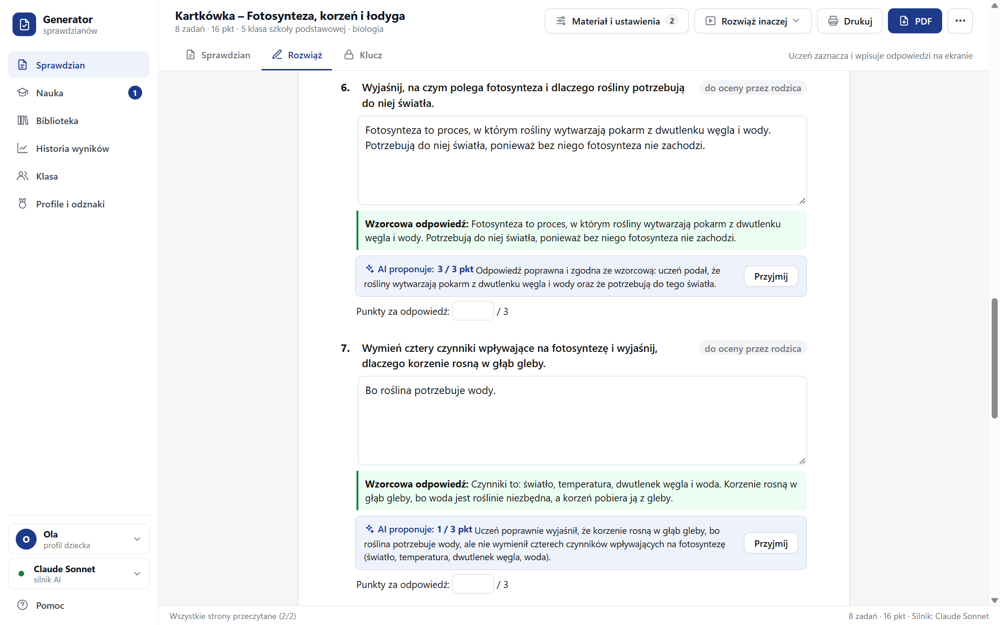

**Historia wyników – wykres postępów i skuteczność w rodzajach zadań**


**Grupa B – druga wersja sprawdzianu**

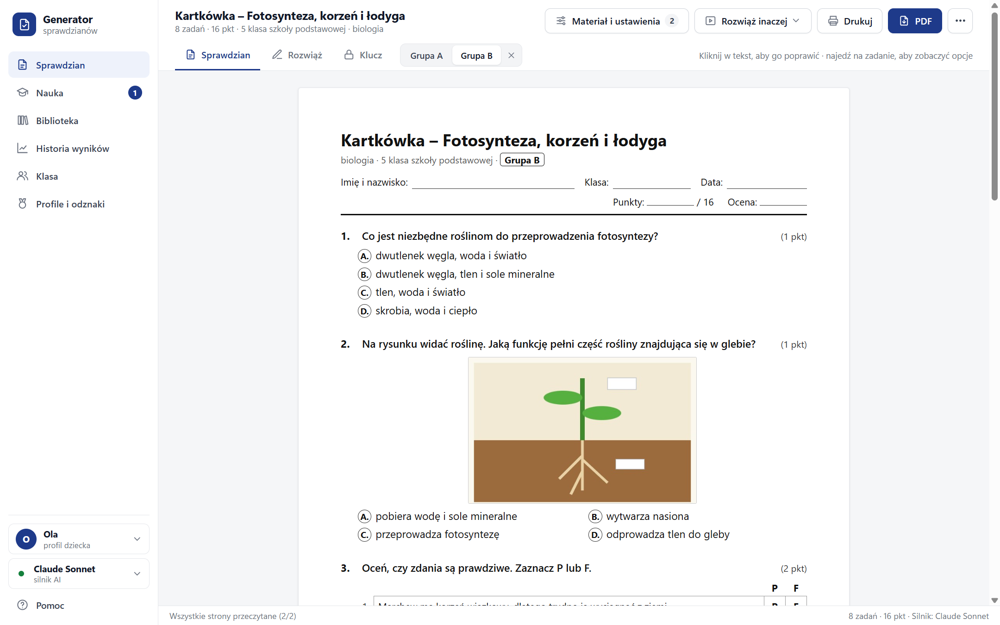

**Opcjonalny limit czasu – odliczanie startuje po kliknięciu „Zaczynam”**


**Rozwiązywanie na telefonie lub tablecie (po zeskanowaniu kodu QR z programu)**

<p>
  
  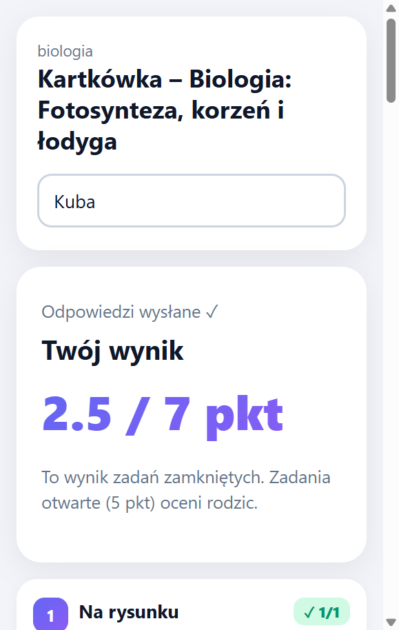
</p>

**Sprawdzanie kartki ze zdjęcia – AI odczytało odpowiedzi z zeskanowanej kartki (niepewne zaznacza na żółto)**


**„Wyjaśnij moje błędy” – wyjaśnienie dla dziecka pod zadaniem**


**Quiz-gra – pytania na czas, punkty i seria poprawnych odpowiedzi**


**Tryb klasy – ranking quizu na żywo z kilku tabletów**

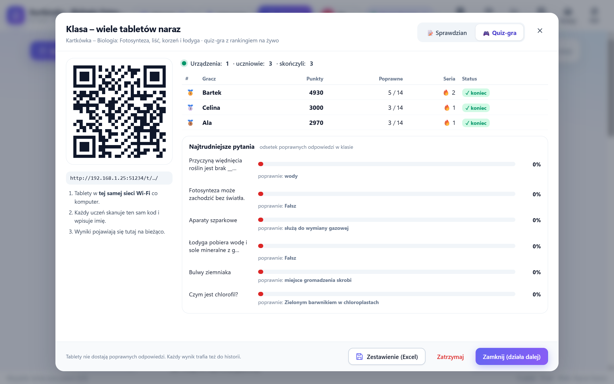

**Tryb klasy – wyniki sprawdzianu i najczęstsze błędy**


**Quiz na telefonie**

<p>
  
  
</p>

**Plan nauki przed sprawdzianem**


**Fiszki z powtórkami rozłożonymi w czasie**


**Profile dzieci i odznaki**

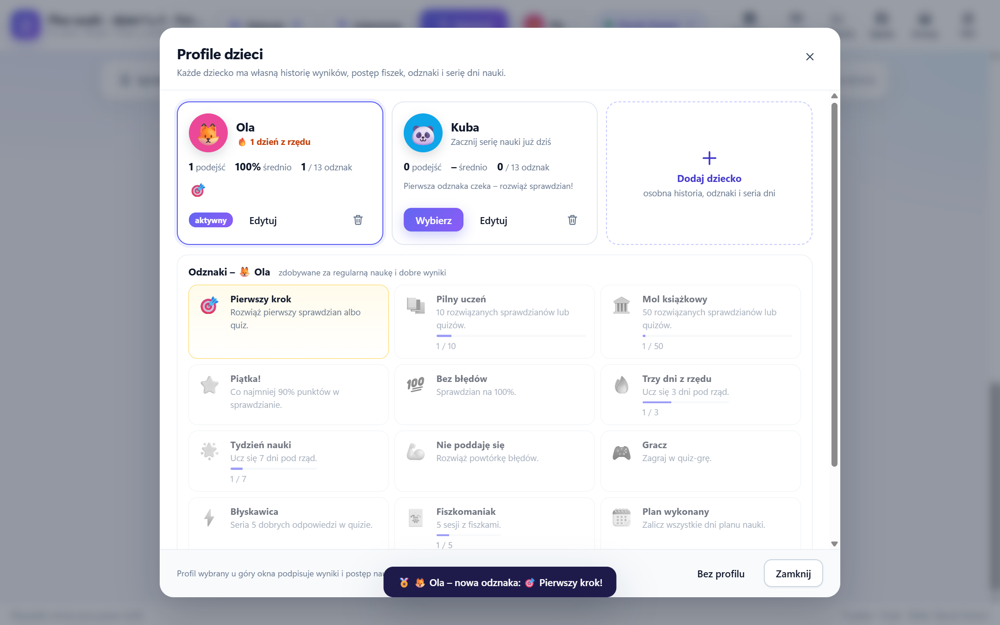

**Biblioteka sprawdzianów**


**Tryb ciemny**


**Wybór silnika AI**

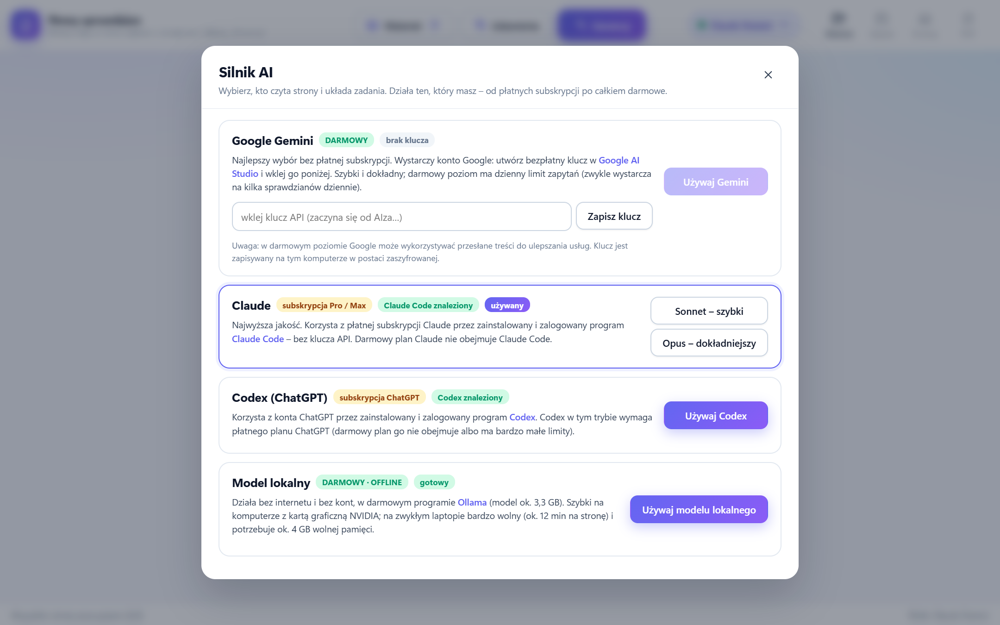

</details>

## Instalacja

1. Pobierz plik `Generator-sprawdzianow-Setup-….exe` z zakładki **[Releases](../../releases)**.
2. Uruchom go i zainstaluj.
   - Windows może ostrzec, że aplikacja pochodzi od nieznanego wydawcy, bo instalator nie jest podpisany certyfikatem. Kliknij wtedy „Więcej informacji” → „Uruchom mimo to”.
3. Przy pierwszym uruchomieniu wybierz **silnik AI** (patrz niżej).

Od wersji 1.1.0 program aktualizuje się sam: nowa wersja pobiera się w tle i instaluje przy zamknięciu programu (Pomoc → Sprawdź aktualizacje). Wersje 1.0.x trzeba jednorazowo zaktualizować ręcznie, instalując nowy plik z Releases.

## Silnik AI: co wybrać?

Strony czyta i zadania układa model AI. Do wyboru masz cztery silniki:

| Silnik | Koszt | Czego potrzebujesz | Szybkość |
|---|---|---|---|
| **Google Gemini** | **darmowy** | konto Google i bezpłatny klucz z [Google AI Studio](https://aistudio.google.com/apikey) | strona ok. 20 s, sprawdzian ok. 20–40 s |
| **Claude** (Sonnet / Opus) | subskrypcja Claude Pro lub Max | zainstalowany i zalogowany [Claude Code](https://claude.com/product/claude-code) | strona ok. 20 s, sprawdzian ok. 20 s |
| **Codex** (ChatGPT) | płatna subskrypcja ChatGPT | zainstalowany i zalogowany [Codex](https://developers.openai.com/codex) | strona ok. 30 s, sprawdzian ok. 45 s |
| **Model lokalny** | **darmowy, offline** | program [Ollama](https://ollama.com/download) i ok. 3,3 GB na model | z kartą graficzną szybki; na zwykłym laptopie ok. 12 min na stronę |

- **Nie masz płatnej subskrypcji?** Wybierz **Google Gemini**: wystarczy darmowy klucz.
  - W programie: Narzędzia → Silnik AI → wklej klucz → „Zapisz klucz”.
  - Darmowy poziom Gemini ma dzienny limit zapytań. Zwykle wystarcza na kilka sprawdzianów dziennie.
  - W darmowym poziomie Google może wykorzystywać przesłane treści do ulepszania swoich usług.
- **Bezpłatne plany Claude i ChatGPT nie wystarczą.** Claude Code wymaga planu Pro lub wyższego. Codex w trybie używanym przez program wymaga płatnego planu ChatGPT.
- **Model lokalny** działa całkowicie bez internetu, ale na komputerze bez karty graficznej jest bardzo wolny.

Program sam wykrywa zainstalowane Claude Code, Codex i Ollamę. Klucz Gemini jest zapisywany na Twoim komputerze w postaci zaszyfrowanej.

## Jak używać

1. **Materiał** (Ctrl+M): dodaj zdjęcia stron, plik PDF albo cały folder.
   - AI czyta strony w tle. Przeczytane strony są zapamiętywane, więc następnym razem są gotowe od razu.
   - Kliknięciem zaznacz strony, z których ma być sprawdzian.
2. **Ustawienia** (Ctrl+,):
   - rodzaj: kartkówka albo sprawdzian,
   - poziom trudności,
   - rodzaje zadań,
   - liczba zadań,
   - grafiki,
   - klasa i przedmiot.
3. **Generuj** (Ctrl+G).
4. **Popraw:**
   - Kliknij w tekst, aby go zmienić.
   - Po najechaniu na zadanie możesz kliknąć **Inne zadanie**, zmienić punkty albo przesunąć zadanie.
   - Grafikę można przykadrować.
5. **Rozwiąż** (Ctrl+3): uczeń rozwiązuje sprawdzian na komputerze.
   - Klika odpowiedzi ABC oraz P/F, wybiera litery w dopasowaniach, wpisuje wyrazy w luki i odpowiedzi na pytania otwarte.
   - Po kliknięciu „Zakończ i sprawdź” zadania zamknięte są oceniane automatycznie (✓/✗).
   - Rodzic po podaniu hasła widzi poprawne odpowiedzi i przyznaje punkty za pytania otwarte. Przycisk **„Podpowiedź oceny z AI”** proponuje punkty z krótkim komentarzem – rodzic je zatwierdza.
   - **Powtórka błędów:** „Rozwiąż jeszcze raz błędne” (te same zadania, przemieszane odpowiedzi) albo „Nowe zadania z tych zagadnień” (AI).
   - **Wyjaśnij moje błędy:** AI tłumaczy każdą pomyłkę prostym językiem (pod zadaniem) i podpowiada, co doczytać.
   - Wynik zapisuje się w **historii wyników** (Narzędzia → Historia wyników, Ctrl+H).
6. **🔒 Klucz** (Ctrl+2): przy pierwszym otwarciu ustawiasz hasło rodzica.
7. **Na tablecie** (Ctrl+T albo przycisk nad kartką): pokaż kod QR i zeskanuj go tabletem lub telefonem w tej samej sieci Wi-Fi. Tablet nie dostaje poprawnych odpowiedzi – sprawdza je program; wynik trafia do historii. Przy pierwszym użyciu Windows może zapytać o dostęp do sieci – zezwól na sieci prywatne.
   - **Limit czasu** (opcjonalny): Ustawienia → „Limit czasu na rozwiązanie”. Działa w trybie „Rozwiąż” i na tablecie.
8. **Grupa B** – przycisk nad kartką: te same zadania przemieszane albo inne zadania z tego samego materiału (AI). Grupy przełączasz nad kartką; każda ma własny klucz.
9. **Drukuj albo PDF** (Ctrl+P, Ctrl+E).
10. **Kartka** (przycisk nad kartką, Ctrl+K): zdjęcia albo skan PDF rozwiązanego, wydrukowanego sprawdzianu. AI odczytuje odpowiedzi; sprawdzasz odczyt (niepewne miejsca są zaznaczone), poprawiasz i klikasz „Zakończ i sprawdź”. Za zadania otwarte AI proponuje punkty.
11. **Quiz** (przycisk nad kartką, Ctrl+J): zadania zamknięte jako gra – każde zdanie P/F, para i luka to osobne pytanie na czas. Na tablecie: w oknie „Na tablecie” wybierz „Quiz-gra”.
12. **Tryb klasy** (Narzędzia → Tryb klasy albo „Cała klasa →” w oknie tabletu): jeden kod QR dla wszystkich tabletów. Wyniki pojawiają się na bieżąco; „Podgląd” otwiera odpowiedzi ucznia, „Oceń otwarte z AI” ocenia zadania otwarte całej klasy, „Zestawienie” zapisuje plik CSV dla Excela. W quizie – ranking na żywo.
13. **Profil** (przycisk u góry): dodaj dzieci; wybrany profil podpisuje wyniki, ma własny postęp fiszek, odznaki i serię dni nauki.
14. **Nauka** (Ctrl+L):
    - **Plan nauki:** data sprawdzianu i materiał → codziennie kartkówka z kolejnej części materiału, dzień przed sprawdzianem próbny sprawdzian. Zadania na dziś widać też na ekranie startowym.
    - **Fiszki:** AI przygotowuje zestaw z wybranych stron; oceniasz „Nie wiem / Trudne / Wiem / Łatwe”, a program planuje kolejne powtórki.
15. **Biblioteka** (Ctrl+B): wszystkie sprawdziany zapisują się same – razem ze stronami i grafikami. Wyszukiwanie po tytule, temacie, przedmiocie i treści pytań. Plik możesz też zapisać i otworzyć ręcznie (Ctrl+S, Ctrl+O).

Motyw jasny, ciemny albo systemowy: Widok → Motyw.

**Dobre zdjęcia:** jedna strona na zdjęcie, prosto z góry, przy dobrym świetle i bez cienia dłoni. Zdjęcia HEIC z iPhone'a trzeba zapisać jako JPG.

## Prywatność

- Zdjęcia stron są wysyłane tylko do wybranego silnika AI. Wyjątek to model lokalny, przy którym nic nie opuszcza komputera.
- Program nie ma własnego serwera i nie zbiera żadnych danych.
- Klucz odpowiedzi, hasło (zapisane jako skrót, nie wprost), ustawienia, biblioteka stron, biblioteka sprawdzianów, profile dzieci, plany, fiszki i historia wyników są zapisywane lokalnie w `%APPDATA%\Generator sprawdzianów`.
- Przy podpowiedzi oceny z AI i przy wyjaśnianiu błędów do wybranego silnika trafiają pytania, poprawne odpowiedzi i odpowiedzi ucznia (bez imienia).
- Przy sprawdzaniu kartki ze zdjęcia do wybranego silnika trafiają zdjęcia kartki (z imieniem wpisanym przez dziecko, jeśli jest na kartce).
- Aktualizacje są pobierane z GitHub Releases tego projektu.
- Rozwiązywanie na tablecie działa tylko w Twojej sieci lokalnej: program uruchamia na ten czas małą stronę pod losowym, jednorazowym adresem i wyłącza ją po zatrzymaniu (najpóźniej po 3 godzinach). Nic nie przechodzi przez internet. W quizie każdą odpowiedź sprawdza komputer – tablet nie dostaje klucza.

## Dla programistów

Wymagany jest [Node.js](https://nodejs.org) 20 lub nowszy.

```bash
npm install
npm start          # uruchomienie
npm run dist       # instalator Windows w katalogu dist/
```

W Windows możesz też kliknąć dwukrotnie `Uruchom.bat`, który przy pierwszym uruchomieniu sam zainstaluje zależności.

| Plik | Rola |
|---|---|
| `src/main.js` | okno, menu, wybór silnika, biblioteka stron (kolejka w tle + pamięć), hasło rodzica, PDF, pliki |
| `src/engines/claude.js` | Claude Code w trybie bezgłowym (`claude -p --json-schema`) |
| `src/engines/codex.js` | Codex CLI (`codex exec --output-schema`) |
| `src/engines/gemini.js` | Gemini API (`generateContent`, odpowiedź JSON wg schematu, automatyczny wybór dostępnego modelu) |
| `src/engines/ollama.js` | model lokalny przez Ollamę |
| `src/engines/common.js` | wspólny schemat zadań i polecenie dla AI |
| `src/remote.js`, `src/remote/tablet.html` | rozwiązywanie na tablecie i tryb klasy: serwer w sieci lokalnej i strona dla tabletu |
| `src/remote/quiz.js`, `src/remote/quiz.css` | quiz-gra – wspólny silnik dla komputera i tabletu (punktacja i sprawdzanie także po stronie serwera) |
| `src/ocr.js` | Tesseract (polski) – odcinanie podpisów z wycinków grafik |
| `src/renderer/` | interfejs (`index.html`, `styles.css`, `app.js`, `features.js` – powtórka błędów, historia, grupy A/B, ocena AI, aktualizacje; `features2.js` – PDF, limit czasu, tablet; `features3.js` – profile i odznaki, biblioteka sprawdzianów, fiszki, plan nauki; `features4.js` – quiz-gra, tryb klasy, kartka ze zdjęcia, wyjaśnianie błędów) |

## Licencja

[GPL-3.0](LICENSE). Możesz używać, zmieniać i rozpowszechniać program, ale zmienione wersje też muszą pozostać otwarte.
